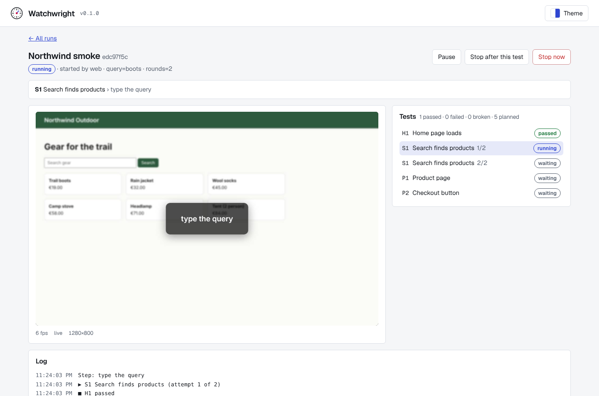

# Watchwright

**Browser test and benchmark runs you can watch, pause, fix and score, on your own machine, driven by your own AI agent.**

Watchwright is a test harness built on [Playwright](https://playwright.dev). It's for the runs plain `npx playwright test` isn't made for: long ones that take minutes or hours, where a broken step should pause rather than end the run, where you score what each attempt produced, or where your agent does the driving while you look on.

- **Bench your AI feature across models.** One pack runs per model or setting (`runs: { by: "model", q9: 3, haiku: 1 }`), every attempt keeps its screenshots, text and video, a rubric scores it, and Compare lines the runs up side by side.
- **Let your agent test and fix your site while you watch.** Claude Code, Codex or any MCP client starts runs, reads results and writes tests. You see the browser live, a broken test pauses for you to fix and retry, and anything that deletes data waits for your approval.
- **Check your site on a schedule.** Schedules start runs by themselves and alerts reach your phone or chat. The attempt that broke keeps its video, trace and log.

Try it in one command (Node.js 22 or newer):

```bash
npx watchwright demo
```

It starts a run of the [TodoMVC example pack](examples/todomvc) against Playwright's public demo app and opens it in your browser. Not sure whether you need Watchwright or Playwright Test? [Watchwright or Playwright Test?](https://dumiflex.github.io/watchwright/guide/watchwright-or-playwright-test) says when to use which.

## What it does

- **Watch it.** Every run streams a live picture of the browser to Watchwright's own web page, with the current test, step and log.
- **Control it from the page.** Start, pause, resume, retry, skip and stop runs on the website, and review what each test saved: screenshots, text, metrics, video and Playwright traces. Or let a schedule start them, and an alert on your phone or in a chat tell you when one fails.
- **Test any site.** You write test packs for your own websites: a folder with a `pack` file and test files in the familiar Playwright style.
- **Let your agents drive.** Everything the page does is an API call, and AI coding agents (Claude Code, Codex, any MCP client) get it through a CLI, an MCP server and an agent skill. Watchwright has no AI assistant of its own.
- **Built to grow.** Every capability is a plugin on one core of browser sessions, jobs, events and actions. Testing comes first; scraping, crawling and other Playwright capabilities can be added later without reworking the base.

> **Status: early (0.x).** The run engine, test packs in TypeScript or YAML, the live view, the web app (runs, review, compare, a pack editor and Record), schedules, alerts, secrets, saved sign-ins, the HTTP API, the command line, the MCP server and the agent skill work; see [docs/plan.md](docs/plan.md) for the plan and what is built so far.

**Docs:** [dumiflex.github.io/watchwright](https://dumiflex.github.io/watchwright/)

<picture>
  <source media="(prefers-color-scheme: dark)" srcset="docs/screenshots/run-live-dark.png">
  
</picture>

## Requirements

- Node.js 22 or newer
- Windows, macOS or Linux. Windows is the first platform the run engine is checked on.

## Getting started

```bash
npx playwright install chromium firefox
npx watchwright serve     # starts the server at http://127.0.0.1:7420/ and opens it
```

The package is [`watchwright` on npm](https://www.npmjs.com/package/watchwright). To run it from a clone instead (pnpm 9; `corepack enable` sets it up from `package.json`):

```bash
pnpm install
pnpm --filter watchwright exec playwright install chromium firefox
pnpm serve            # builds, starts the server and opens it
```

`npx watchwright demo` does all of this for the TodoMVC example: it gets Chromium if it's missing, starts the server and starts a run.

Then add a test pack on the Packs page (browse to a folder with a `pack.ts` or `pack.yaml` file, or start a new one from a starter) and start a run. The [TodoMVC example](examples/todomvc) is a small pack to try first. [Writing a test pack](packages/site/guide/test-packs.md) explains how to write a pack, and the [HTTP and WebSocket API](packages/site/reference/http-api.md) lists every route, event and the live WebSocket.

`watchwright serve` options:

| Option | Default | What it does |
|---|---|---|
| `--port` | `7420` | Port for the web page and the API. |
| `--host` | `127.0.0.1` | Address to bind. Only loopback addresses are allowed until token auth is built. |
| `--data` | see below | Folder for the database and everything runs save. |
| `--no-open` | off | Don't open the web page in your browser on start. |

The data folder is, in order: `--data`, the `WATCHWRIGHT_DATA` environment variable, or the usual app data folder (`%LOCALAPPDATA%\Watchwright` on Windows, `~/Library/Application Support/Watchwright` on macOS, `~/.local/share/watchwright` on Linux).

## Development

```bash
pnpm dev              # server (watch mode) + web dev server at http://127.0.0.1:5173/
pnpm test             # Vitest, server and web (engine tests need the Playwright browsers)
pnpm typecheck        # tsc + vue-tsc
pnpm lint             # ESLint
pnpm build            # server to packages/watchwright/dist, web app to packages/watchwright/dist/web
pnpm site:dev         # docs site at http://localhost:5173/watchwright/
pnpm site:build       # docs site to packages/site/dist
```

The repository is a pnpm workspace:

| Path | What |
|---|---|
| `packages/watchwright` | The `watchwright` package: server, plugin host, store, run engine, pack API and CLI. |
| `packages/web` | The Vue 3 + Vite web app. Its build is served by `watchwright serve`. |
| `packages/site` | The docs site (VitePress): landing page, guide and API reference. |
| `docs/` | The plan and research notes. |

## Contributing and releases

Pull requests go to the `dev` branch and need a [Conventional Commits](https://www.conventionalcommits.org) title such as `feat: pause a run from the page` or `fix: keep the live view after a reload`. When `dev` is merged into `main`, a release is cut automatically: the version is worked out from those titles, and the notes go to [CHANGELOG.md](CHANGELOG.md) and the GitHub releases page. Watchwright is in 0.x, so any release may change how things work.

## Safety

The server listens on `127.0.0.1` only. It refuses requests whose `Host` header isn't its own loopback address and port, and refuses changes and WebSocket connections from other origins, so web pages open in your browser can't drive it.

Test packs are code that runs on your machine with your permissions. Only load packs you trust.

## Support

Watchwright is free and made by one person. If it helps you, you can support it through [GitHub Sponsors](https://github.com/sponsors/DumiFlex), [Buy Me a Coffee](https://buymeacoffee.com/dumiflex) or [PayPal](https://paypal.me/dumiflex). More on the [About page](https://dumiflex.github.io/watchwright/about).

## License

Copyright 2026 DumiFlex. Licensed under the [Apache License, Version 2.0](LICENSE); see [NOTICE](NOTICE).
