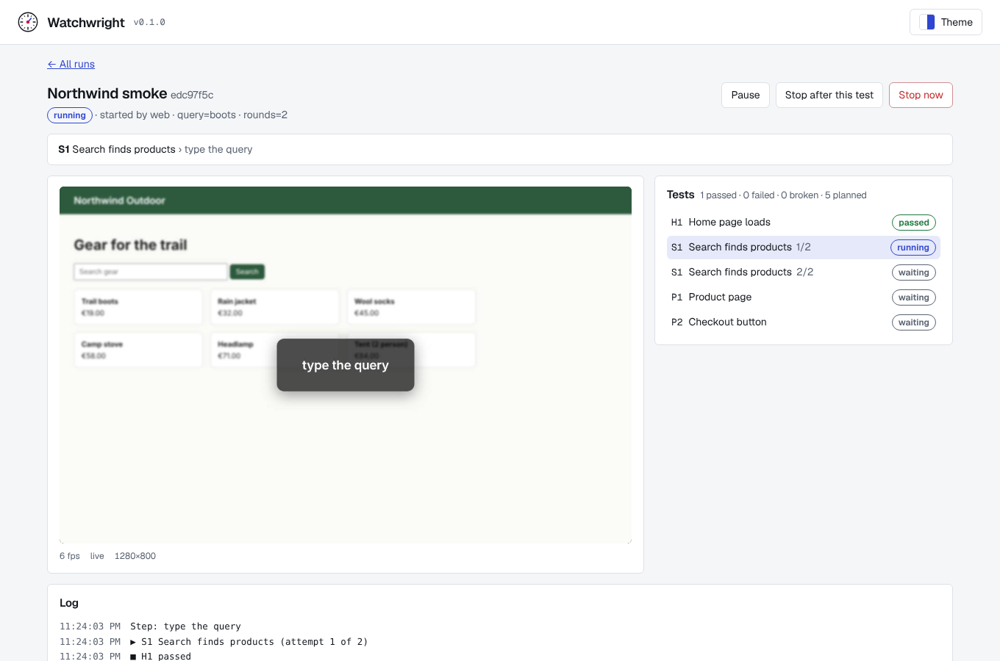

# Watchwright

[](https://www.npmjs.com/package/watchwright)
[](https://www.npmjs.com/package/watchwright)
[](https://github.com/DumiFlex/watchwright/actions/workflows/ci.yml)
[](https://nodejs.org)
[](https://github.com/DumiFlex/watchwright/blob/main/LICENSE)
[](https://dumiflex.github.io/watchwright/)
[](https://github.com/sponsors/DumiFlex)
[](https://buymeacoffee.com/dumiflex)

**Browser tests you can watch live, pause, fix and review, on your own computer or your own server.**

Watchwright runs [Playwright](https://playwright.dev) tests from its own server and web page. You see the browser while each test runs, a broken step pauses the run so you can fix the test and retry it, and every attempt keeps its screenshots, video, trace and log for review. Runs can start on a schedule, and AI coding agents can drive it too.

It's good for:

- **End-to-end tests of a web app**, written in TypeScript in the Playwright style, in YAML, or recorded by clicking through the site.
- **Long or fragile flows**, where a failure should pause for you rather than end a run that took an hour to get there.
- **Comparing setups**: the same tests with different settings (a browser, a language, a feature flag), runs side by side, and scores when a person judges the result.
- **Watching a live site**, with scheduled runs and alerts to your phone or chat.

Try it in one command (Node.js 22 or newer):

```bash
npx watchwright demo
```

It starts a run of the [TodoMVC example pack](examples/todomvc) against Playwright's public demo app and opens it in your browser. Not sure whether you need Watchwright or Playwright Test? [Watchwright or Playwright Test?](https://dumiflex.github.io/watchwright/guide/watchwright-or-playwright-test) says when to use which.

## What it does

- **Watch it.** Every run streams a live picture of the browser to Watchwright's own web page, with the current test, step and log.
- **Control it from the page.** Start, pause, resume, retry, skip and stop runs, and review what each test saved: screenshots, text, metrics, video and Playwright traces. [Reviewing](https://dumiflex.github.io/watchwright/guide/reviewing)
- **Test any site.** A test pack is a folder with a `pack` file and tests in the familiar Playwright style, or in YAML. [Writing a test pack](https://dumiflex.github.io/watchwright/guide/test-packs)
- **See each pack at a glance.** A pack's dashboard shows what matters for it: pass rates, run times, metrics, review scores, a leaderboard per model. [Dashboards](https://dumiflex.github.io/watchwright/guide/dashboards)
- **Run it by itself.** Schedules start runs, and alerts reach your phone or chat when one fails. [Schedules](https://dumiflex.github.io/watchwright/guide/schedules) · [Alerts](https://dumiflex.github.io/watchwright/guide/alerts)
- **Let your agents drive.** Everything the page does is an API call, and AI coding agents (Claude Code, Codex, any MCP client) get it through a CLI, an MCP server and an agent skill. Watchwright has no AI assistant of its own. [Agents](https://dumiflex.github.io/watchwright/guide/agents)
- **Host it for a team.** A Docker image, login with roles and single sign-on, share links and a public status page, and runners that let a server reach sites on your own PC. [Self-hosting](https://dumiflex.github.io/watchwright/guide/self-hosting)

> **Status: early (0.x).** Everything above works today; any release may still change how things work. See the [changelog](CHANGELOG.md).

**Docs:** [dumiflex.github.io/watchwright](https://dumiflex.github.io/watchwright/)

<picture>
  <source media="(prefers-color-scheme: dark)" srcset="docs/screenshots/run-live-dark.png">
  
</picture>

## On your computer

Needs Node.js 22 or newer, on Windows, macOS or Linux.

```bash
npx playwright install chromium firefox
npx watchwright serve     # the server and its web page at http://127.0.0.1:7420/
```

Then add a test pack on the Packs page (a folder with a `pack.ts` or `pack.yaml`, or a new one from a starter) and start a run. [Getting started](https://dumiflex.github.io/watchwright/guide/getting-started) walks through it, and the [command line](https://dumiflex.github.io/watchwright/reference/cli) lists every option.

## On a server, with Docker

```bash
docker run -d --name watchwright --init --shm-size 1g --restart unless-stopped \
  -p 7420:7420 \
  -v /opt/watchwright/data:/data -v /opt/watchwright/packs:/packs \
  -e WATCHWRIGHT_PUBLIC_URL=http://192.168.1.20:7420 \
  ghcr.io/dumiflex/watchwright:latest
```

The image (`linux/amd64` and `linux/arm64`) holds the server, the web app and the browsers. Login is always on: the log prints a link that creates the first admin. Make the two folders first, owned by uid 1001.

- [Self-hosting](https://dumiflex.github.io/watchwright/guide/self-hosting): Docker Compose, Portainer, reverse proxies (NPMplus, Caddy, Tailscale), updates and backups.
- [Runners](https://dumiflex.github.io/watchwright/guide/self-hosting#runners): a server's runs reach a site that only runs on your PC, such as `localhost:3000`, with one copied command on that PC.
- [Single sign-on](https://dumiflex.github.io/watchwright/guide/single-sign-on): OpenID Connect (Authelia, Authentik, VoidAuth…) or a trusted proxy header.
- [Sharing](https://dumiflex.github.io/watchwright/guide/sharing): read-only share links for one run, and a public status page.

## Safety

On your computer the server listens on `127.0.0.1` only, refuses requests for any other address, and refuses changes from other sites' pages, so a web page open in your browser can't drive it. On a server, login is on and every action checks the person's role. Test packs are code that runs with the server's permissions: only load packs you trust. [Safety](https://dumiflex.github.io/watchwright/guide/safety)

## Development

From a clone (pnpm 9; `corepack enable` sets it up):

```bash
pnpm install
pnpm --filter watchwright exec playwright install chromium firefox
pnpm dev              # server (watch mode) + web dev server at http://127.0.0.1:5173/
pnpm serve            # build, then run the server
pnpm lint && pnpm typecheck && pnpm test
```

`packages/watchwright` is the server, run engine and CLI, `packages/web` the Vue web app, `packages/site` the docs site, and `docs/` the plans and research notes. [AGENTS.md](AGENTS.md) has the layout and conventions.

Pull requests go to the `dev` branch with a [Conventional Commits](https://www.conventionalcommits.org) title such as `feat: pause a run from the page`. Merging `dev` into `main` cuts a release by itself: the version comes from those titles, and the notes go to [CHANGELOG.md](CHANGELOG.md).

## Support

Watchwright is free and made by one person. If it helps you, you can support it through [GitHub Sponsors](https://github.com/sponsors/DumiFlex), [Buy Me a Coffee](https://buymeacoffee.com/dumiflex) or [PayPal](https://paypal.me/DumiFlex). More on the [About page](https://dumiflex.github.io/watchwright/about).

## License

Copyright 2026 DumiFlex. Licensed under the [Apache License, Version 2.0](LICENSE); see [NOTICE](NOTICE).
