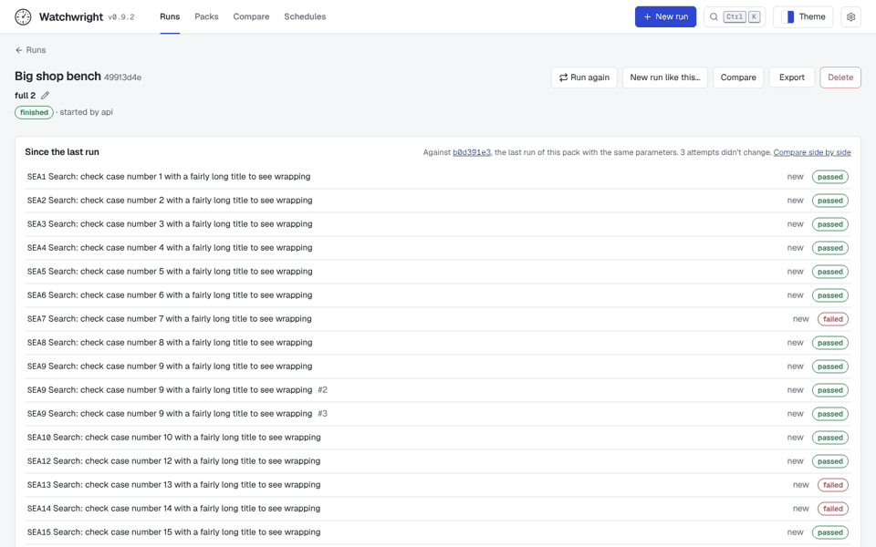
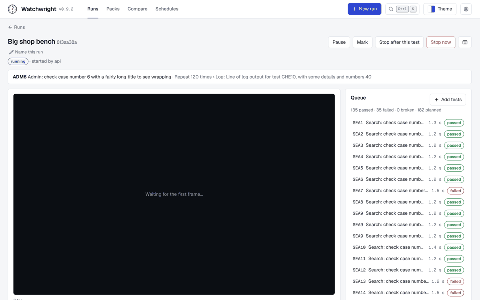
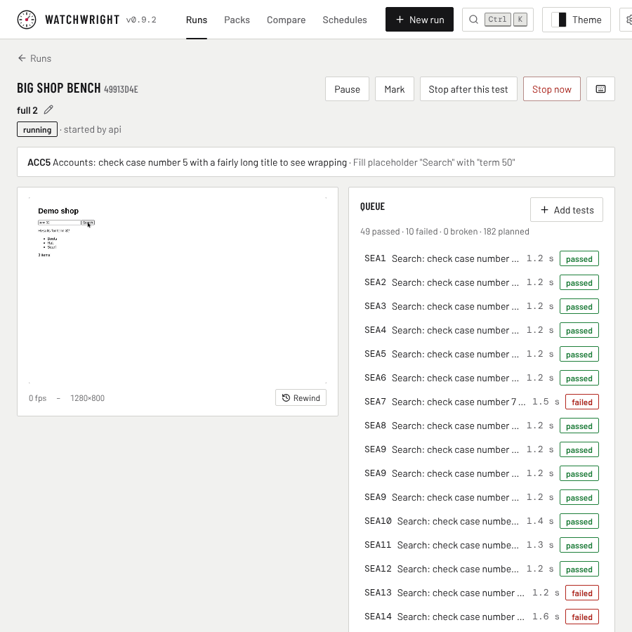
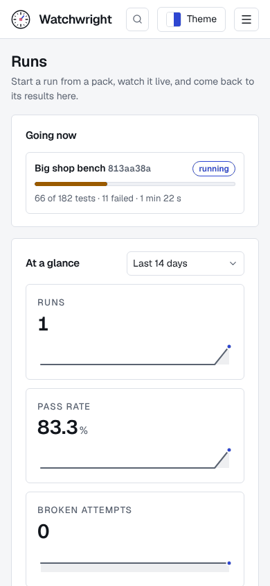
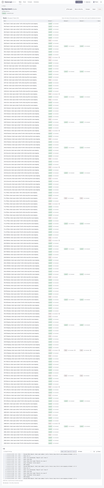
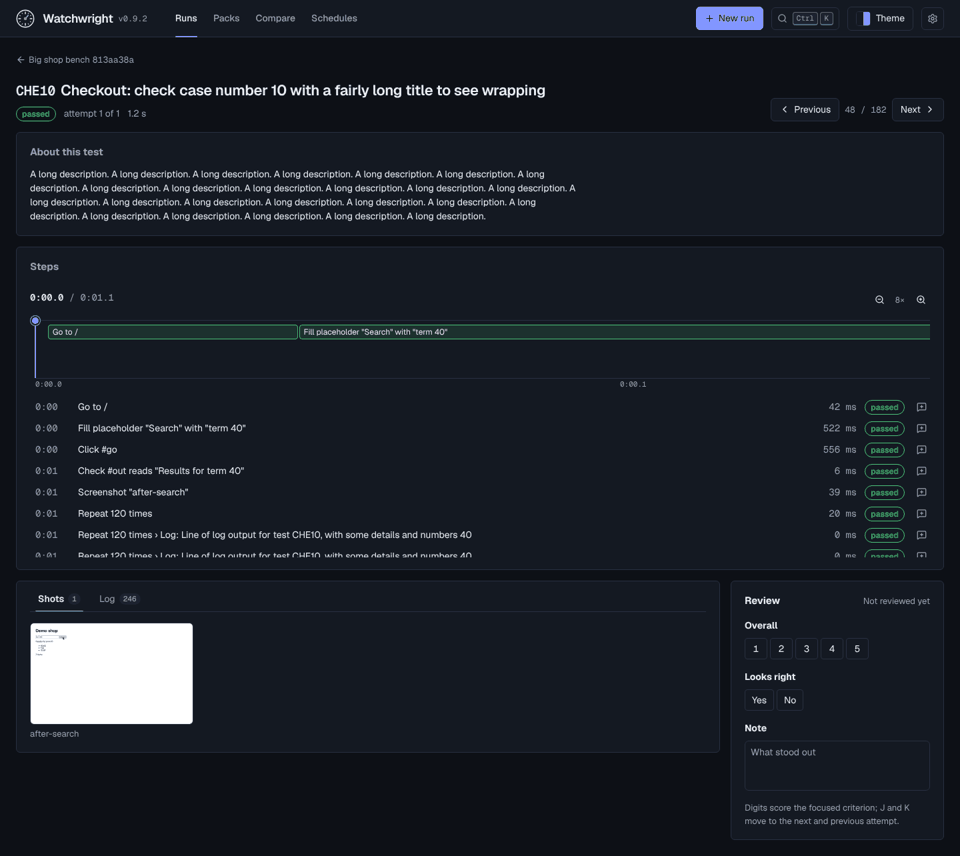
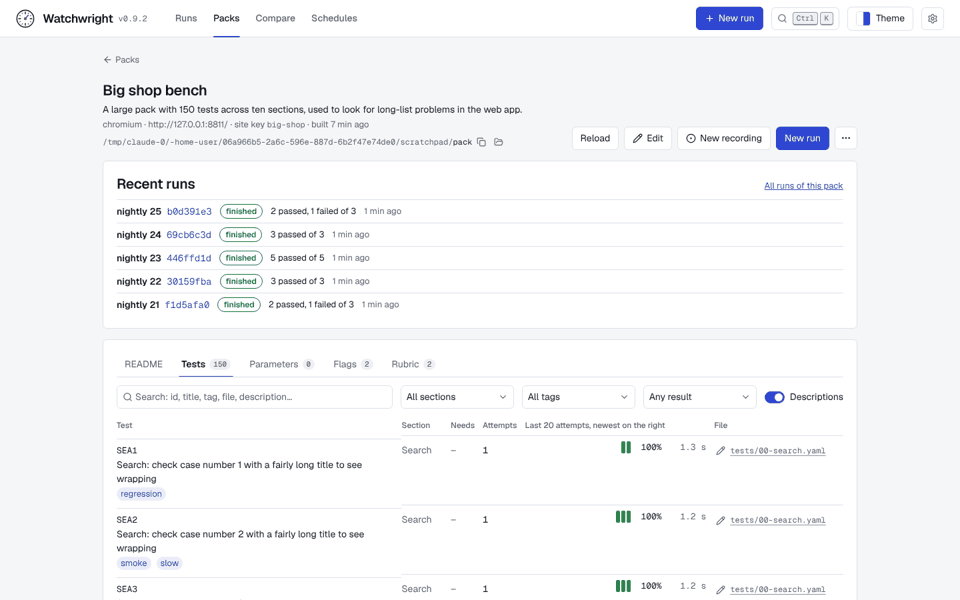
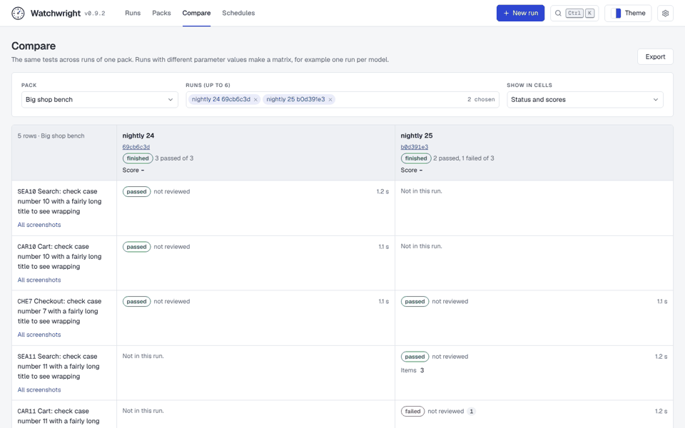
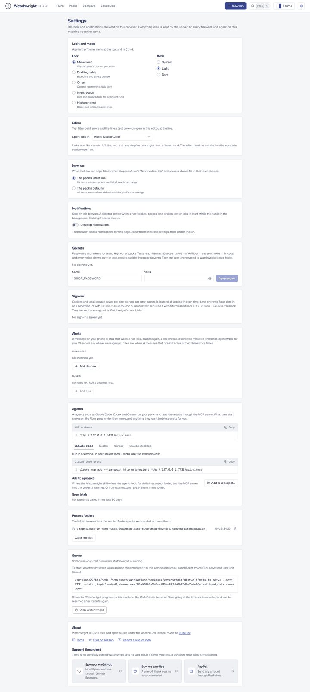

# UX audit: traps at scale

A pass over the whole web app looking for the kind of trap people hit in real use: a primary action out of reach, a list with no end and no search, an overlay over the content, a control that does nothing, a label that says the wrong thing. It follows three such traps found by hand in October 2026 (a pack's README and recent runs under a 126-test list, a step caption covering the screen, a rewind with no player) and a fourth being fixed on its own (Start run at the bottom of a long Planned list on New run).

## How it was tested

A seeded server with data at the size a real bench reaches:

- one pack with **150 tests** in ten sections, long titles, tags, long descriptions on a quarter of them, three attempts on some, a 120-line log on every tenth, a failing check on every seventh, flags and metrics;
- **30+ runs**: four full runs (182 attempts each) and many small ones, some queued;
- every page (Runs, a live run, a finished run, an attempt, Packs, a pack and its tabs, the editor, Compare, Schedules, Settings) at 1440, 1000, 900, 800, 390, 360 and 320 px, in all five looks, light and dark.

## Findings, worst first

| # | Where | Trap | Status |
|---|---|---|---|
| 1 | Run page, Since the last run | A full run was compared with the last run with the same parameters, often a quick run of three tests, and listed the other 179 attempts as "new": about 7,000 px of rows above the run's own results. | Fixed in #138: compare with the last run of the same tests; list only attempts that moved, ten at first; count the rest. |
| 2 | Run page, Results | 150 rows with no search or filter: finding the 31 failed tests meant scrolling past every passed one, and the run's log sat under all of it. On a phone a long title pushed every status off screen. | Fixed in #139: search, and Show failed or broken / not reviewed / flagged; one-line titles on a phone. |
| 3 | Live run, Queue | The queue stayed at its top while the running test moved a hundred rows down, out of view, for most of a long run. | Fixed in #137: the queue follows the running row until you scroll it elsewhere. |
| 4 | Live run, status banner | Opening a running run replays its events. The replayed steps overwrote the banner, which showed an old test's step for seconds (longer on a run with hours of events). | Fixed in #137: replayed events fill the log only. |
| 5 | Every page, top bar | Between 641 and about 1010 px (a half-screen window, a tablet) the bar ran past the window and hid the settings button; on a phone the Drafting table look pushed the menu off the edge. | Fixed in #135. |
| 6 | Attempt page | A long test description filled a phone's first screen and pushed the failure below it. | Fixed in #141: folds to four lines with Show all. |
| 7 | Runs page, phone | The four At a glance tiles stacked one per row (about 600 px), so the runs list started far below the first screen. | Fixed in #140: two tiles a row. |
| 8 | Labels | "64 of 182 tests" counted attempts (the pack has 150 tests); the queue said "182 planned"; a queued run in Recent runs read "0 passed of 0". | Fixed in #137 and #141. |
| 9 | Attempt page, Review | The Review panel sits under the steps and the shots. On an attempt with many steps it starts below the first screen, so reviewing 182 attempts means scrolling on each one (J and K help, but the scores are out of view). | Open: needs a layout choice (below). |
| 10 | Pack page, Tests tab | 150 tests at about 104 px a row make a 21,500 px page. The search and filters scroll away with it, and titles wrap in a narrow column. | Open: needs a layout choice (below). |
| 11 | Compare | 150 tests across runs, with no way to show only the tests whose results differ, and tall rows (the test column is narrow). | Open (below). |
| 12 | Settings | Eleven sections in one 3,200 px page with no way to jump to one. | Open (below). |
| 13 | Opening a long live run | The page replays every event of the run before it is current: thousands of log lines on a 182-attempt run, far more on an overnight bench. #137 keeps the banner right meanwhile, but the replay itself still costs seconds and memory. | Open: a server change (below). |
| 14 | Runs page, desktop | At a glance (tiles and a chart) comes before the runs list, which starts about 840 px down at 1440 x 900. | Open: a choice for Dumi. |

Not traps, checked and fine: Packs, Schedules (empty and filled), the editor at phone width, the log viewer (virtual, capped at 5,000 lines, search and levels), the step timeline with 120 repeated steps (scrolls in its own box), every look's controls.

## Proposals (all built)

These changed a page's layout or the server, so they waited for a decision. All six were chosen and built: #143, #144, #146, #147, #148 and #149 (the chart folded behind **Show chart**).

1. **Attempt page: review beside the evidence.** On wide screens put Review in a right-hand column that stays in view (sticky) next to the steps and shots, instead of under them; on a phone keep it where it is, with a "Review" jump in the header. Small to medium.
2. **Pack Tests tab: built for 150 tests.** Keep the search and filters stuck to the top of the tab while the list scrolls; one line per test (title with an ellipsis, tags beside it, description in the row's tooltip or under a toggle); group rows under their section with a collapse per section and a count. Medium.
3. **Compare: only what differs.** A "Only tests that differ" switch (status, flags, score or time, the same rule as Since the last run) and a search, on by default past a dozen tests. Small.
4. **Settings: a section list.** A list of the sections down the side on wide screens (in the page's flow on a phone), each a link to its section, highlighting the one in view. Small.
5. **Open a live run at its tail.** Let the live channel take "the last N events of this run" instead of everything after 0, and have the run page ask for the last 5,000 (what its log keeps anyway). Server and client, small to medium.
6. **Runs page order.** Either the runs list first and At a glance after it, or At a glance folded to one line of numbers with the chart behind a "Show chart" toggle that the browser remembers. Small; which is a matter of taste.

## Screenshots

Before the fixes, from the seeded server:

| | |
|---|---|
|  |  |
|  |  |
|  |  |

Before the proposals:

| | |
|---|---|
|  |  |
|  | |
