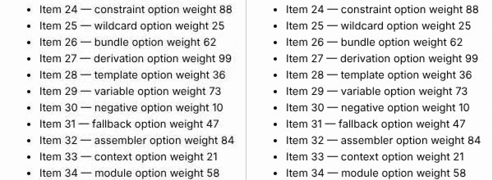

# Videos for people to watch

Dumi asked on 4 November 2026 for two video features, out of the research on recording tutorials with Watchwright: a video quality meant for people to watch, and an attempt video that follows the page the live view follows across tabs and popups. This note looks at how videos are written now, measures what a sharper video costs, and picks a design. Both features are general: any pack that wants a demo, a tutorial or a bug report someone will watch can use them.

## How videos are written now

- **Attempt videos**, one per page (`video-p1.webm`, `video-p2.webm`, …), kept by `run.video` (always, problems, never). See [video-size.md](video-size.md) for the qualities.
  - At `full` in Chromium and WebKit, Playwright writes them: VP9, CRF 8 under a bit rate that grows with the pixel rate (1 Mbit/s for 800×450 at 25 frames a second, so about 5.8 Mbit/s at 1920×1080), every frame repeated to a steady 25 a second.
  - At `full` in Firefox (flash filter on), and at `compact` and `small` in every browser, Watchwright writes them itself from the screencast frames (`RunVideo`): `full` at 1 Mbit/s, `compact` and `small` at a constant quality.
  - The screencast is one per page, shared by the live view and the video. Its JPEG quality is the pack's `run.frameQuality` (default 70), and Playwright's own recorder takes the frames at that quality too (the first client's settings win).
- **The run video** (`runVideo`): one video of the page the live view follows, for the whole run, at 10 frames a second and 600 kbit/s. It already follows new tabs and popups, because it reads the frame hub's newest frame of the session's active page.

So a demo that opens a new tab gets two or three videos, and a busy 1080p page in Firefox gets 1 Mbit/s, which smears small text when much moves at once.

## Measurements

A 13-second recording at 1920×1080 in Chromium of a page built to be hard: 13 px text in three columns, typing into a text box, a canvas of boxes and curves being dragged, a list scrolled fast. Frames were saved once at JPEG 70 and once at 92, then encoded with ffmpeg's VP9 at the realtime speed recording uses. PSNR is against the frames the encoder got (higher is closer; 40 dB is visibly soft on text, 50 dB looks like the page).

| Encoding | Frames | Size | PSNR | Encode time (one 13 s clip) |
|---|---|---|---|---|
| Watchwright `full` (Firefox path): 1 Mbit/s, cpu-used 8, 1 thread | JPEG 70 | 3.7 MB | 41.0 dB | 4.9 s |
| Playwright `full` (Chromium path): 5.8 Mbit/s cap, 25 fps steady | JPEG 70 | 5.0 MB | | 3.2 s |
| CRF 32, cpu-used 8 | JPEG 92 | 4.7 MB | 45.7 dB | 5.3 s |
| CRF 24, cpu-used 8 | JPEG 92 | 5.8 MB | 50.1 dB | 5.3 s |
| **CRF 24, cpu-used 6, 2 threads** | JPEG 92 | **3.5 MB** | **50.4 dB** | **4.7 s** |
| CRF 24, cpu-used 5, 2 threads | JPEG 92 | 5.2 MB | 50.3 dB | 5.0 s |
| CRF 20, cpu-used 8, 4 threads | JPEG 92 | 6.2 MB | 51.3 dB | 3.8 s |

- **cpu-used 6 is the sweet spot**: the same speed as 8 here, a third smaller and slightly sharper. Realtime needs the encoder to keep up with the frames; at about a third of real time on one or two cores it does, with room to spare, and `RunVideo` already skips frames instead of queueing when the disk or CPU falls behind.
- **The frames matter as much as the encoder.** A still frame of small text at JPEG 70 is 33 dB against the same frame at 100 (ringing around every letter); at 90 it is 41 dB, and the ringing is gone. So the sharp quality raises the screencast's JPEG quality to at least 90 for the run. The live view gets the same frames, about 1.5 times the bytes.
- **Constant quality costs nothing on still pages.** On this busy clip the sharp encoding is the same size as `full`; on a page that waits (a demo explaining, a test waiting for a server) it takes far less than `full`'s fixed bit rate.
- **VP8** (older Playwright, ffmpeg 1011) does badly with a pure constant quality (`-b:v 0`): 27 dB at CRF 24. With a quality and a cap (`-crf 8 -qmax 40 -b:v 4M`) it gets 47.5 dB at 4.8 MB. Playwright 1.64 ships VP9, so this is only a fallback.
- **Frame rate.** Chromium's screencast sends at most about 26 frames a second at 1080p; the sharp quality samples 30 times a second, so it keeps every frame the browser sends.

Side by side at the busiest frame (the list scrolling): `full` at 1 Mbit/s on the left, the sharp encoding on the right.

## Options

1. **Raise `full`.** Every bench run would pay for it in CPU and room. No.
2. **A new quality above `full`.** Opt-in, for packs and runs meant to be watched. Yes.
3. **One video per attempt across tabs**, three ways:
   - Join the per-page videos after the attempt with ffmpeg. Needs to know which page was shown when, and encodes twice. No.
   - Ask Playwright for a context-wide video. It has none: videos are per page.
   - **Write the attempt's video from the frames of the page the live view follows**, the way the run video does, but per attempt and at the attempt's quality. The session already knows the active page and keeps each page's newest frame. Yes.

## Design

**Quality `high`** ("High: sharp, for videos people watch").

- A fourth value of the video quality: `high`, `full`, `compact`, `small`. VP9 at CRF 24, `-cpu-used 6`, two threads, sampled 30 times a second, from screencast frames at JPEG 90 or more (the pack's `frameQuality` when higher). VP8 fallback: CRF 8 under 4 Mbit/s. Watchwright writes every video itself at this quality, as it does for `compact` and `small`.
- It applies to attempt videos and the run video (which records at 30 frames a second at `high` instead of 10).
- Where it's set, first match wins: the run's `videoQuality` option (New run, `runs.start`), the pack's `run.videoQuality`, then the server's Video quality setting (Admin > Storage), which also gets High. The server setting stays the default for everything; a pack meant for demos sets `high` for its own runs. Running low on disk still stops videos whatever the quality.
- **Compress kept videos leaves `high` videos alone.** They were asked for to be watched, so shrinking them later would undo the point. A run's videos can still be deleted with the run.

**Attempt video that follows the live view** (`run.followVideo: true`, run option `followVideo`).

- Instead of one video per page, each attempt records one video, `video.webm`, of the page the live view follows: the main page, then a new tab or popup the moment it opens, then back when it closes or a test acts on another page. Pauses (a broken attempt waiting) are in it, as in the run video.
- The video keeps the screencast size (`run.screencastSize`, else the viewport); a page of another size is centered, cropped or padded, never stretched.
- `run.video` still decides which attempts keep it (always, problems, never), and the quality is the run's quality. It needs Playwright's ffmpeg, like every video Watchwright writes; without it the run goes on without video and says so once.
- The live view (and so this video) used to go back to the test's main page on every `h` helper, `h.wait` and `h.step` included, so a popup the test opened left the view a moment later. Only helpers that act on the page (`goto`, `click`, `fill`, `press`, `scrollShots`) now make their page the one the view follows; the rest still wait out a pause but leave the view where it is.
- It's a boolean beside `video` and `runVideo` rather than a new `video` value, so "follow, but keep only problems" can be said.
- New run gets a Quality choice and a "One video across tabs" switch under Video; Run again and presets keep both.

## Not in this change

Playwright's `showActions` options, a presentation mode (no retries, no pause on a broken attempt), and a steady cursor drawn by the pack: the tutorial research lists them; Dumi hasn't asked for them yet.
